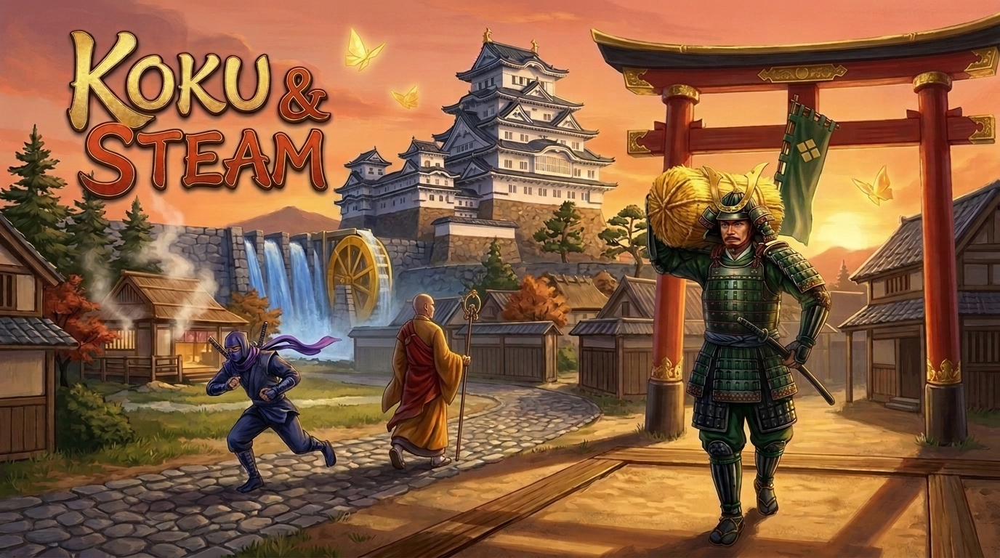

# Koku & Steam: The Mitochondrial Village
### *A 2.5D Isometric Bioenergetics, Redox Thermodynamics & Metabolic Simulator*

[](https://chris24main.github.io/Koku_and_Steam/)
[-blue?style=for-the-badge&logo=adobeacrobatreader)](https://chris24main.github.io/Koku_and_Steam/Koku%20%26%20Steam%20-%20Field%20Manual.pdf)
[-orange?style=for-the-badge&logo=adobeacrobatreader)](https://chris24main.github.io/Koku_and_Steam/Koku%20%26%20Steam.pdf)
[](LICENSE)
[]()



> **"What if cellular respiration wasn't an abstract textbook diagram, but a bustling feudal Japanese river village operating on strict thermodynamic principles?"**

**Koku & Steam** is an interactive, zero-dependency bioenergetics simulation running entirely in the browser. Every enzyme complex, electron carrier, thermodynamic gradient, allosteric feedback loop, and metabolic hormone is physically embodied as an autonomous architectural landmark, cargo carrier, or villager.

---

## 🎮 Play & Explore Live

- **🌐 [Play in Browser (GitHub Pages Root)](https://chris24main.github.io/Koku_and_Steam/)** — Runs the live production build with modular runtime.
- **📦 [Self-Contained Single-File Bundle (V6)](https://chris24main.github.io/Koku_and_Steam/koku_steam_mitochondrial_village_simulation_V6.html)** — Completely standalone (HTML + CSS + JS in a single `570 KB` file; download and double-click to play anywhere offline).
- **📖 [Printable 3-Page Field Manual (PDF)](https://chris24main.github.io/Koku_and_Steam/Koku%20%26%20Steam%20-%20Field%20Manual.pdf)** — Retro 90s-style slip-in instructional manual with complete mechanics, crisis drills, and keyboard shortcuts.
- **📄 [Printable Game Overview & Marketing Brochure (PDF)](https://chris24main.github.io/Koku_and_Steam/Koku%20%26%20Steam.pdf)** — 3-page overview highlighting the biochemical depth, win states, and educational design.

---

## 🔬 Core Biochemical Metaphor

Nothing in *Koku & Steam* is arbitrary scripting. Every dynamic in the village emerges from first-principles biochemistry and thermodynamic laws:

| Feudal Metaphor | Cellular & Biochemical Equivalent | Role & Mechanism |
| :--- | :--- | :--- |
| **Conveyor Yards (Left Bank)** | $\beta$-Oxidation & Glycolysis | Fuel supply lines competing via the **Randle Cycle**. |
| **Membrane Bridge** | Inner Mitochondrial Membrane (IMM) | Crosses from the Cytosolic Left Bank into the Matrix Island. |
| **Straw Bales (*Tawara*)** | $\text{NADH} / \text{FADH}_2$ | High-energy reducing equivalents hauled in handcarts. |
| **White Flour Sacks** | Ubiquinol ($\text{CoQH}_2$) | Milled at Complex I & II; ferried by blue-tunic $\text{CoQ}$ porters. |
| **Mochi Dough Balls** | Reduced Cytochrome *c* | Steamed at Complex III; carried on lacquer trays by swift red couriers. |
| **Complexes I–IV** | Electron Transport Chain (ETC) | Step-down redox stations marked with Roman numerals (`I`–`IV`). |
| **Elevated Stone Dam** | Proton Motive Force ($\Delta\Psi_m$) | $\text{H}^+$ gradient pumped into the Intermembrane Space. |
| **Castle Complex V** | $\text{F}_1\text{F}_0$ ATP Synthase | Waterwheel driven by $\text{H}^+$ dam pressure, minting golden **Koku**. |
| **Golden Koku Bales** | $\text{ATP}$ | Conserved currency paid to the Samurai garrison to fund training/work. |
| **Samurai Garrison** | Conserved Adenylate Pool ($\text{ATP} : \text{ADP} : \text{AMP}$) | Strict $15–25$ warrior pool cycling between Castle, Dojo, and Wellhouse. |
| **Adenylate Kinase (AK)** | $2\,\text{ADP} \rightleftharpoons \text{ATP} + \text{AMP}$ | Emergency energy pooling; paired Ronin trade fuel and ring the alarm. |
| **Onsen Spillway** | $\text{UCP1}$ Proton Leak (Thermogenesis) | Sluice gates open to vent dam backpressure harmlessly as steam. |
| **GSH Wellhouse & Brigade** | Glutathione ($\text{GSH}$) & Catalase Defense | Water buckets dousing reactive oxygen species ($\text{ROS}$) fires. |
| **Origami Butterflies** | Ketone Bodies ($\beta\text{-HB}$, $\text{AcAc}$, Acetone) | Folded during low-glucose/high-fat states; dive-bomb fires & aid recovery. |
| **AMPK Ninjas** | $\text{AMP}$-Activated Protein Kinase | Energy sensors performing selective mitophagy and garrison pruning. |
| **mTORC1 Zen Monks** | Mammalian Target of Rapamycin | Anabolic master builders constructing the Proteostasis Shrine. |
| **River-Spirit Maiden** | Gluconeogenesis ($\text{GNG}$) / GLUT2 | Mystical maiden ferrying newly synthesized glucose back across the river. |

---

## 🏆 Three Intentional Win Conditions

In human metabolism, **there is no effortless middle-slider setting that maintains health indefinitely.** Leaving sliders on autopilot causes the cell to drift into stress. Thriving requires **active, intentional management**, unlocking three distinct **Matsuri Festival** victories (with a *"Continue Playing"* mode to remain in the thriving world):

```
       [ HIGH WORKLOAD (Exercise / Stress) ]
                 │ (PGC-1α Priming)
                 ▼
       [ RECOVERY / FEEDING (Post-Workout Feast) ]
                 │ (mTORC1 Scaffolding / Supercompensation)
                 ▼
       [ BALANCED FASTING (Zen Rest & Clearance) ]
                 │ (AMPK Ordination in Onsen)
                 ▼
        🏆 +1 NEW SAMURAI (Peak Biogenesis: 25/25)
```

1. **🏆 Super Capacity (`25 / 25` Samurai — Peak Mitochondrial Biogenesis):**
   Execute the complete 3-phase physiological cycle: push through **High Workload** ($\text{PGC-1}\alpha$ priming), transition into **Recovery / Feeding** ($\text{mTORC1}$ supercompensation), and seal the gains in **Balanced Fasting** ($\text{AMPK}$ ordination). Each cycle ordains a Zen Monk into a Samurai until reaching peak garrison reserve (`25/25`).
2. **☯️ Metabolic Flexibility (`AMPK ↔ mTOR` Dynamic Cycling):**
   Demonstrate true cellular plasticity by actively oscillating between anabolic building and catabolic pruning—cycling the garrison up ($\ge 2$) and down ($\ge 2$) within $16–24$ around a baseline of $18–22$.
3. **⚖️ Steady-State Homeostasis (`> 5` Minutes of Clean Balance):**
   Discover a self-sustaining metabolic balance—such as fasting down to a lean garrison ($17$ Samurai) and sustaining active, fat-adapted workload ($100\%$ Fat, $10\%$ Glucose, $71\%$ Work) for over $300\text{ seconds}$ without crises or high ROS.

> *Note on the **Austere Lean Minimum (`15/25`)**: Prolonged sedentary fasting without exercise prompts AMPK Ninjas to prune surplus garrison down to 15 warriors. This is a non-blocking advisory state reminding the player that spare reserve is exhausted.*

---

## ⚠️ Six Pathologies & Biological Recovery

Pushing parameters to extremes triggers genuine cellular disease states—each featuring dedicated 3-act visual transitions, sound effects, and recovery options:

- **👹 Apoptosis (Bioenergetic Failure):** Relentless demand without fuel starves the Castle queue. Desperate Samurai desert into rogue Ronin. If Ronin exceed $60\%$, they stage a full-scale revolt, breach the Membrane Bridge ($\Delta\Psi_m \to 0\text{ mV}$), and kneel in *seppuku*, releasing $12$ *Toro Nagashi* lanterns into the night.
- **☠️ Acute Necrosis & Ferroptosis (Toxin Overload):** Toxic insults overwhelm the GSH Wellhouse, bringing Xenobiotic Bandits who breach defenses, ignite the village, blow the bridge, and burst the Onsen sluice as they flee (*DAMPs* damage-associated molecular patterns release).
- **🌾 Bioenergetic Starvation (Zero-Fuel Exhaustion):** Cutting off all fuel forces the village to consume endogenous reserves (Lactate, Glycerol, and Muscle Alanine). Once depleted, Ronin sheathe their blades, and the village powers down into a silent, dull-grey brownout with drifting tumbleweeds.
- **🏛️ Cellular Senescence (High-Glucose Anabolic Stagnation):** Unchecked chronic glucose over-activates mTORC1, completing the Proteostasis Shrine ($100\%$) and freezing all villagers in a solemn circle around the temple amidst chronic SASP inflammatory fires.
- **🫧 Hepatic Steatosis / NAFLD (The Randle Collision):** Flooding the sedentary cell with **both high fat and high glucose** causes intracellular lipid accumulation, cytosolic fires, and insulin resistance—reducing traffic to a $0.32\times$ crawl with sheathed swords.
- **🧪 Warburg Fermentation & Press-Pulse Recovery:** Severe ETC scarring ($\ge 55\%$) shifts energy production to cytosolic fermentation bogs. **Recovery is biologically possible:** apply the **Press** ($\text{Glucose} < 10\%$, $\text{Fat} > 80\%$, $\text{Toxin} < 5\%$) and time a **Pulse** strike when succinate accumulates to repair the ETC below $30\%$ and restore oxidative phosphorylation.

---

## 🛠️ Tech Stack & Architecture

- **Zero External Runtime Dependencies:** Pure HTML5 Canvas + vanilla JavaScript (ES6+).
- **Modular Development Architecture:**
  - `index.html` — Application shell, control deck, live gauges, and inspector panels.
  - `v3_core.js` — Core 2.5D isometric renderer, spatial coordinate engine, carrier pathfinding, and baseline ETC mechanics.
  - `v4_expansion.js` — Plastic garrison logic ($15–25$), hormonal cascades (AMPK, mTORC1, PGC-1α), ketone aerial dynamics, pathology state machines, audio synthesis, and the 3 Matsuri win states.
- **Single-File Bundler:** `scripts/bundle_v6.mjs` compiles all modular files into the standalone distribution `koku_steam_mitochondrial_village_simulation_V6.html` (`570 KB`).

---

## 🚀 Quickstart & Local Development

### Option 1: Direct Browser Play (No Installation)
Clone the repository and open either `index.html` or `koku_steam_mitochondrial_village_simulation_V6.html` directly in any modern browser:

```bash
git clone https://github.com/Chris24main/Koku_and_Steam.git
cd Koku_and_Steam
# Open in browser
xdg-open index.html          # Linux
open index.html              # macOS
start index.html             # Windows
```

### Option 2: Run with a Local Web Server
If preferred, serve via Python or Node:

```bash
# Python 3
python3 -m http.server 8000

# Node.js
npx serve .
```
Navigate to `http://localhost:8000`.

### Rebuilding the V6 Single-File Bundle
When editing `v3_core.js`, `v4_expansion.js`, or `index.html`, re-bundle the standalone deliverable with:

```bash
node scripts/bundle_v6.mjs
```

---

## 📂 Repository File Structure

```text
├── index.html                                        # Production entry point (served at GitHub Pages root)
├── koku_steam_mitochondrial_village_simulation_V6.html # Standalone single-file bundle (all-in-one HTML/CSS/JS)
├── v3_core.js                                        # Core isometric engine, pathfinding, and ETC mechanics
├── v4_expansion.js                                   # Garrison plasticity, win conditions, pathologies & audio
├── koku_and_steam_banner.jpg                         # 90s retro-styled banner artwork
├── Koku & Steam - Field Manual.pdf                  # 3-Page printable game & instructional manual
├── Koku & Steam.pdf                                  # 3-Page printable marketing & technical overview
├── Design document - Koku & Steam.md                 # Full technical design and biochemistry specification
├── Summary_of_the_features.md                        # Pedagogical feature breakdown & release notes
├── IMPLEMENTATION_TRACKER.md                         # Milestone and feature verification log
├── scripts/
│   └── bundle_v6.mjs                                 # Inlining build script generating V6 HTML bundle
├── LICENSE                                           # CC0 1.0 Universal Public Domain Dedication
└── README.md                                         # This documentation
```

---

## 📜 License

This project is released under the **[Creative Commons CC0 1.0 Universal](LICENSE)** (Public Domain Dedication). You are free to use, adapt, teach with, and build upon this work for personal, educational, or commercial purposes.
